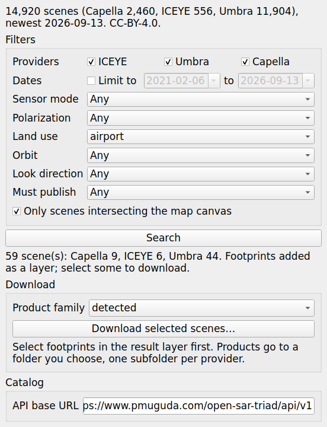

# Open SAR Triad for QGIS

The open-sar-triad catalog inside QGIS: filter the open SAR scenes published
by ICEYE, Umbra and Capella, add the matching footprints as a layer, and
download the products you select. No account, no key: the catalog is a static
API rebuilt weekly, and every download comes straight from the provider's own
storage.



## Install

**From the plugin repository** (once listed): Plugins › Manage and Install
Plugins › search "Open SAR Triad".

**From a ZIP**: download `open_sar_triad-<version>.zip` from the
[releases page](https://github.com/pmuguda/open-sar-triad/releases), then
Plugins › Manage and Install Plugins › Install from ZIP.

**From a checkout** (development): build the ZIP yourself and install it the
same way.

```bash
python3 scripts/build_qgis_plugin.py       # writes dist/open_sar_triad-<version>.zip
```

Needs QGIS 3.22 or newer, including the Qt6-based QGIS 4. Nothing else: the
Python client the plugin uses ships inside it. CI runs the plugin's tests
inside QGIS 3.22, the 3.44 long-term release, 4.0 and 4.2, so a change that
breaks one of them cannot land on main.

## Use

1. Click the Open SAR Triad toolbar button (also under Web › Open SAR Triad).
   The panel loads the catalog stats and fills the filter lists from them.
2. Pan the map to the area you care about. By default the search is limited to
   scenes intersecting the map canvas; untick that for a global search.
3. Narrow by provider, date window, sensor mode, polarization, land use, orbit,
   look direction, or the product family a scene must publish.
4. **Search.** The matching footprints are added as a memory layer, coloured
   by provider the same way the web app colours them. The attribute table
   carries the scene id, acquisition date, mode, polarization, land use tags,
   the formats published, incidence angle, a thumbnail link, a link into the
   web app framed on that scene, and one download URL per product family.
   Right-click a footprint for "Open in the web app" and "Open thumbnail".
5. Select footprints (any QGIS selection tool), pick a product family, and
   **Download selected scenes**. The plugin says how many files it will fetch
   before it starts; SAR products are large, a single file can exceed 1 GB.
   Files land in `<folder>/<provider>/`, metadata sidecars alongside, and
   files already present are skipped. Progress shows in the QGIS task bar
   and the download can be cancelled there.

Each search replaces the previous result layer. To keep a result, export the
layer (right-click › Export) before searching again.

### Product families

Providers name the same kind of product differently, so the plugin asks for a
family and resolves the format each scene actually publishes:

| family | resolves to |
|---|---|
| detected | GEO, GRD, GEC or SIDD, in that order |
| complex | SLC or SICD |
| phase | CPHD |
| visual | CSI or VID |

## Publishing to the QGIS plugin repository

Being listed at [plugins.qgis.org](https://plugins.qgis.org) is what makes the
plugin appear when someone searches the QGIS plugin manager. Uploads there are
tied to an OSGeo account, so this is the one step the repository cannot do on
its own. Once:

1. Create an OSGeo user id at https://id.osgeo.org if you do not have one.
2. In this repository's settings, add two Actions secrets: `OSGEO_USERNAME`
   and `OSGEO_PASSWORD`.

Then every release tagged `qgis-v<version>` builds the ZIP, attaches it to
the release, and uploads it to plugins.qgis.org (`publish.yml`, via
`scripts/upload_qgis_plugin.py`). Without the secrets the release still
carries the ZIP and the workflow says what is missing.

The first upload of a new plugin is reviewed by the repository's maintainers
before it is listed; that can take a few days. Later versions appear
immediately. The version in `metadata.txt` must be new for every upload and
must match the release tag, which the workflow checks.

To upload by hand instead: https://plugins.qgis.org/plugins/add/ with
`dist/open_sar_triad-<version>.zip`.

The package meets the repository's requirements: `metadata.txt` with
homepage, tracker and repository links, `LICENSE` inside the package (a copy
of the repository's, kept in sync by the build script), no binaries, well
under 20 MB, and `supportsQt6` declared and tested.

## How it is built

`qgis/open_sar_triad/` is the plugin. `vendor/client.py` is a byte-for-byte
copy of the Python client in `python/opensartriad/`, refreshed by
`scripts/build_qgis_plugin.py`; the test suite fails if the two drift. Network
work runs in QGIS tasks so the window never freezes, and `records.py`, which
decides what the attribute table shows, has no QGIS dependency so it is tested
on plain Python. The rest is tested headlessly inside a QGIS container in CI.

Land use tags describe what a map says is at each location, not what the
radar shows. Scene metadata is CC-BY 4.0; credit the originating provider when
you publish derived work.
